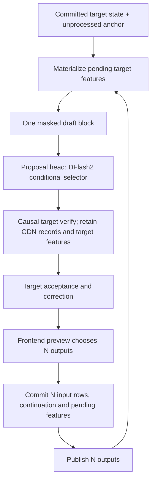

# DFlash and DFlash2

DFlash backends propose several tokens with one masked-block forward, conditioned on committed
target hidden features. The target verifies the proposal causally and remains the output authority.
NInfer implements DFlash and DFlash2 as optional components of the
[Qwen3.5 model](qwen3_5-model.md). Their private config and bindings select the stored weights;
startup chooses one backend, draft width and proposal head.

This reference owns model mathematics, proposal distributions and backend state. Scheduling,
publication and common transactions are defined by [Engine architecture](engine-architecture.md).

## Configuration and current geometries

Both draft configs use `model_type=qwen3` and identify `DFlashDraftModel` or `DFlash2DraftModel`.
They supply draft layer count, attention/FFN dimensions, norm epsilon, one-dimensional RoPE theta,
layer attention types, sliding window, target block IDs and mask token ID. DFlash2 also supplies
convolution tap/group dimensions and selector rank/top-k. The hidden width and embedding/output
semantics come from the target. Exact fields are parsed in
[`config.cpp`](../../src/models/qwen3_5/config.cpp).

| Quantity | Official 35B-A3B DFlash | Official 27B DFlash2 |
|---|---:|---:|
| Hidden width H | 2048 | 5120 |
| Draft layers | 6 | 5 |
| Intermediate width | 6144 | 17408 |
| Q heads / KV heads / head dimension | 32 / 8 / 128 | 32 / 8 / 128 |
| Target block IDs | `[1,6,11,16,22,27,32,37]` | `[5,19,33,47,61]` |
| Attention pattern | Five local layers, then one full layer | Five local layers |
| Sliding-window scalar S | 4096 | 2048 |
| Norm epsilon / RoPE theta | `1e-6` / `1e7` | `1e-6` / `1e7` |
| Dynamic convolution | — | Two taps, group width 16 |
| Candidate selector | Per-position argmax | Top-16 conditional path, rank 256 |

The current Engine accepts startup draft count K in `1..15` and concurrency B in `1..8`. The
physical block width is `W=K+1`, containing one anchor and K masks. K is a runtime choice, not a
weight dimension. Geometry representable in config still needs the actual native Op support;
for example, DFlash2's fused convolution, context materializer and selector implement the listed
27B geometry.

## Target conditioning and context

Let F be the target's processed-token frontier. The target has consumed positions `[0,F)` and
already selected the next token `a=x_F`, which is the unprocessed anchor. Before proposing, the
backend materializes any committed pending target features so its context also reaches F.

For each processed position t, let `r_t^l` be the complete residual output of zero-based target
block l, after both mixer and FFN residual additions. Conditioning is:

```text
s_t = concat(r_t^l for l in target_layer_ids, in recorded order)
c_t = plain_rmsnorm(W_feature s_t, context_norm)
plain_rmsnorm(x,w) = w * x / sqrt(mean(x^2) + eps)
```

The feature projection is bias-free. A hidden-state API that counts the embedding as boundary zero
would expose block l at boundary l+1; the stored IDs are block IDs. Features are captured before
the next block's input norm or final Text norm. Multimodal inputs use the same target residual
capture after Vision embedding replacement.

Each draft layer independently projects this common c_t into its context K/V:

```text
k_raw^l(t) = W_context_key^l c_t
k_ctx^l(t) = rope_1d(plain_head_rmsnorm(k_raw^l(t), key_norm^l), position=t)
v_ctx^l(t) = W_context_value^l c_t
```

Context prefill performs feature projection and these K/V projections. It does not run prompt
tokens through the draft residual/MLP stack. Context uses absolute scalar Text cache positions and
full-head split-half RoPE; it does not use the target's partial three-axis MRoPE.

Source K/V parameters are used for both query-block and context projections. Their logical roles
and Uses remain separate; the official recipes share compatible physical data. The representation
of one role can be selected independently of the other.

DFlash2's fused context materializer stores BF16 K and `FP16_RNE(BF16(v_raw))` V. Raw K has no
observable BF16 cast between projection and head normalization. This complete contract is in
[`context_kv_materialize.h`](../../include/ninfer/ops/context_kv_materialize.h). If a prefill chunk
exceeds the local ring capacity, only its final live window needs storage; the context frontier
still advances by the complete chunk.

## Query block and attention masks

The draft input is the target embedding of:

```text
absolute position   F       F+1       F+2       ...       F+K
input token         a       MASK      MASK                MASK
role                anchor  proposal  proposal            proposal
```

The anchor conditions the block but is not sampled from its draft output. Mask output i predicts
the token at the same absolute position, without the target causal LM's next-token shift. All
proposals come from this one forward.

Draft attention is non-causal over context and query-block K/V. For a local layer with scalar S:

```text
allowed(p_query, p_key) = abs(p_key - p_query) < S
```

Endpoints at distance S−1 are included; distance S is excluded. Populated sequence bounds clip
the symmetric interval. With a full left context and `p_query=F+i`, the row sees at most `S-1-i`
context positions, plus all W query rows for the supported widths. A full layer attends all
populated context and query rows. These masks are specified by
[`sliding_window_attention.h`](../../include/ninfer/ops/sliding_window_attention.h) and
[`softmax_attention.h`](../../include/ninfer/ops/softmax_attention.h).

## DFlash backbone and proposal

Each layer uses plain RMSNorm, full-head Q/K normalization and scalar RoPE:

```text
n = plain_rmsnorm(x, input_norm)
q = rope_1d(plain_head_rmsnorm(W_query n, query_norm), positions)
k = rope_1d(plain_head_rmsnorm(W_key n, key_norm), positions)
v = W_value n
a = attention(q, concat(K_ctx,k), concat(V_ctx,v), scale=1/sqrt(D), layer_mask)
y = x + W_output a
m = plain_rmsnorm(y, post_attention_norm)
x_next = y + W_down(SiLU(W_gate m) * (W_up m))
```

After final plain RMSNorm, the mask columns go through the selected proposal head. DFlash uses
per-column argmax, either over public vocabulary rows of the full Text head or over the indexed
proposal head followed by token-ID remapping. Thus its actual proposal q is a point mass, including
when target sampling uses positive temperature.

Changing W can change every proposal because attention is non-causal. A shorter block is not
required to match the prefix of a longer block.

## DFlash2 dynamic convolution

DFlash2 adds a dynamic grouped convolution around both attention and MLP. Each branch has input
and output sides, two taps and a group width of 16. For normalized branch input X, with
`X[b,i,g,j]`, `g=0..H/16-1`, `j=0..15`:

```text
delta = reshape(W_delta X, [B,W,2 sides,2 taps,H/16 groups])

Conv_s(X)[b,i,g,j]
  = (base[s,0,g,j] + delta[b,i,s,0,g]) * X[b,i,g,j]
  + 1{i>=1} * (base[s,1,g,j] + delta[b,i,s,1,g]) * X[b,i-1,g,j]
```

Base coefficients vary by channel; dynamic increments are shared by the 16 channels in a group.
Position zero has no preceding tap. The convolution has no history across requests or rounds.
The output side reuses the delta computed from that branch's normalized input, applying it to the
branch output rather than projecting delta again.

Each DFlash2 layer performs:

```text
n = plain_rmsnorm(x, input_norm)
(prepared_a, finish_delta_a) = attention_conv.prepare(n)
q, k, v = query_key_value(prepared_a)
q, k = plain_head_rmsnorm_and_rope(q, k, positions)
a = noncausal_attention(q, concat(K_ctx,k), concat(V_ctx,v), layer_mask)
y = x + attention_conv.finish(W_output a, finish_delta_a)

m = plain_rmsnorm(y, post_attention_norm)
(prepared_m, finish_delta_m) = mlp_conv.prepare(m)
z = W_down(SiLU(W_gate prepared_m) * (W_up prepared_m))
x_next = y + mlp_conv.finish(z, finish_delta_m)
```

The native fused prepare emits BF16 prepared input and BF16 finish delta. Internal normalized
input and projected coefficients are private intermediates; finish consumes the represented delta
from prepare. The contract is
[`dynamic_grouped_conv.h`](../../include/ninfer/ops/dynamic_grouped_conv.h). After all layers, final
plain RMSNorm produces mask hidden columns for the selector.

## DFlash2 candidate path

For each mask hidden h_i, the selected head produces stable top-16 unary scores u_i and global
token IDs C_i. An indexed proposal head remaps shortlist rows before codebook access. Unary top-16
selection does not apply target penalties, temperature or top-k/top-p/min-p.

Let predecessor/successor codebooks have shape `[vocab_size,R]` and the hidden projection have
shape `[R,H]`. The current selector receives its projected hidden g_i as BF16, candidate scores as
FP32 and codebooks as BF16. For predecessor candidate p and current candidate c:

```text
g_i = W_hidden h_i
pred_token(i,p) = anchor          if i=0
                  C_(i-1)[p]     otherwise
E_i[p,c] = u_i[c] + sum_r W_pred[pred_token(i,p),r] * g_i[r] * W_succ[C_i[c],r]
```

The path is a left-to-right conditional walk using the actual selected predecessor:

```text
temperature <= 0:
    j_i = lowest-rank argmax_c E_i[j_(i-1),c]
    q_i = one_hot(j_i)

temperature > 0:
    q_i[c] = softmax_c(E_i[j_(i-1),c] / temperature)
    j_i ~ q_i

d_(i+1) = C_i[j_i]
```

For i=0 every predecessor row refers to the anchor. This is a conditional walk, not global path
optimization. The Op retains the actual FP32 q_i and global candidate IDs for target correction.
It ignores other target sampling controls. The RNG key uses request seed, `F+i` and the distinct
DFlash2-proposal purpose; compact-batch row does not define random identity. Exact inputs,
tie-breaking and storage are in
[`candidate_selector.h`](../../include/ninfer/ops/candidate_selector.h).

## Target verification and committed prefix

For each request, let P be the number of proposals that can be verified this round, `0<=P<=K`,
and Q=P+1 the target's live input width. The physical allocation still has W columns:

```text
verify input       a       d_1     d_2       ...       d_P
input position     F       F+1     F+2                 F+P
target output      p_0     p_1     p_2                 p_P
predicts position  F+1     F+2     F+3                 F+P+1
```

Proposal d_(i+1) is checked against target p_i. Target distributions include the public vocabulary
mask and configured penalties/temperature/filters, with accepted proposal history added as the
scan advances. Greedy verification accepts the matching target-argmax prefix. At the first
mismatch it emits the target correction; all-accept emits the bonus from p_P.

For positive-temperature target sampling, use the actual proposal distribution:

```text
accept d_(i+1) with probability min(1, p_i[d_(i+1)] / q_i[d_(i+1)])
on rejection: r_i(v) = max(p_i(v) - q_i(v), 0)
              correction ~ r_i / sum_v r_i(v)
on all accept: bonus ~ p_P
```

DFlash q is one-hot; DFlash2 q is the retained conditional distribution. This preserves the
processed target distribution for the verify path. Different draft formats, shortlist heads or
block widths can change acceptance and throughput; their logits need not match one another.

### Live widths

The two backend implementations use different proposal extents near a request tail:

| Extent | DFlash | DFlash2 |
|---|---|---|
| Proposal attention/masked input | Q=P+1 live columns | All W=K+1 columns |
| Target attention and GDN | Q=P+1 live columns | Q=P+1 live columns |
| Candidate prefix checked | First P proposals | First P proposals with their actual q |

DFlash2 computes its configured W-column proposal even when only a prefix can be verified. Its
proposal-valid tensor and target-valid tensor have different meanings. Columns outside the
target live extent have no logical state effect. P=0 verifies only the anchor and selects a target
output.

### Publication and state alignment

If A proposals are accepted, target verification licenses
`y=[d_1,...,d_A,correction_or_bonus]`, with L=A+1 outputs. Frontend preview chooses the final prefix
length N, `0<=N<=L`, accounting for EOS, stop, budget and cancellation.

When N>0, the transaction commits N target input rows `[a,d_1,...,d_(N-1)]` and publishes N output
tokens `[y_1,...,y_N]`. Continuation hidden comes from verify column N−1, and y_N becomes the next
unprocessed anchor. Target KV, GDN Fold, generated-token counters and frontier advance together.
The Fold uses records from this physical verify block, not a separately recomputed numerical path.

The first N columns of captured target features become pending context work. Context may remain at
F while target state advances to F+N. Before the next proposal, or before retaining a checkpoint,
fork or Host replica, those features are materialized and context catches up. N=0 cancellation
commits no new state and releases the sequence; it does not undo earlier adopted commits.

## Open items register

Work this tree has decided not to finish yet, with the measurement that says why. Every entry is
"known unfinished", not "known good".

**Verify rectangle columns 1..K (open, measured).** On v5_e2 with `--spec dflash2
--draft-tokens 8`, the target's own distribution collapses for every column after the anchor while
column 0 stays healthy:

| column | 0 | 1 | 2 | 3 | 4 | 5 | 6 | 7 |
|---|---:|---:|---:|---:|---:|---:|---:|---:|
| draft top-1 inside target top-16 | 85.7% | 0.0% | 8.6% | 22.9% | 20.0% | 14.3% | 22.9% | 28.6% |
| draft top-1 == target argmax | 71.4% | 0.0% | 5.7% | 17.1% | 11.4% | 8.6% | 11.4% | 11.4% |
| top-1 logit | 25.1 | 9.2 | 8.8 | 9.1 | 10.8 | 9.1 | 9.5 | 8.6 |

Two things are ruled out by measurement rather than argument. The columns are addressed correctly:
`NINFER_DFLASH2_DUMP` shows cache and RoPE positions stepping `F, F+1, ... F+7` and each column's
first residual words at O(1), so neither a broadcast column nor a wrong position is the cause. And
the sparse indexer is not the cause: `NINFER_QSA_FORCE_FULL=1` (the dense arm, a different mixer for
every indexed layer) shows the same collapse (column 1: 0.0%, columns 2..7: 0.0-4.3%) while column 0
stays at 73.9/30.4%.

A per-column magnitude probe (`NINFER_VERIFY_COLUMN_PROBE`, `verify_probe.h`) adds a third exclusion:
the rectangle's state is carried, column by column. On the same artifact the GDN recurrence, the
attention mixer and the final fold all report ordinary per-column magnitudes - GDN output 0.0111 /
0.0115 / 0.0111 / ... / 0.0116, attention output 0.0713 / 0.0676 / 0.0647 / ... / 0.0668, final fold
4.31 / 3.79 / 3.41 / ... / 3.30 - so no column is reading a state that never advanced.

The draft block is the remaining suspect, and its mask was tried: `draft.cpp:455` gives every column
the same `valid_columns = width` and `positions = F + i`, and the op takes one shared visible end for
the whole block (`sliding_window/launch.cu:60` passes `positions[0]`, `kernel.cuh:95` reads
`length = positions[0]`, then tiles only `[0, length)`). That end is `F`, so the anchor at `F` is
outside every draft column's key set. Admitting it by moving the end to `F + 1` was implemented,
measured and reverted: the proposal collapsed instead of improving - the first candidate became token
0 in most rounds, column 0's agreement with the target argmax fell from 90% to 0.0%, and k=4 acceptance
went from 33.7% to 0 - because this op reads only the committed context ring (`kernel.cuh:21-33`, no
append, key set `[length - window, length)`), and the drafter's ring ends at `F - 1`: the slot at `F`
holds whatever position `F - window` left there. Making the anchor visible therefore needs the anchor's
row appended to the draft context first (the `context_frontiers` to `frontiers` bookkeeping in
`program/decode.cpp:842`), not a change to the visible end.

That next step was checked against the append accounting before writing it, and the accounting closes
the entry instead: `prepare_ragged_prefix_kernel:21,32` appends `[starts, ends)` with `ends` the
execution frontier and writes `positions = starts + column`, so the draft ring covers `[0, F)` and its
last committed row is position `F-1` - the anchor itself. The key set is `[length - window, length)`
with `length = positions[0] = F` (`kernel.cuh:95,104`), so **every draft column already sees the
anchor's row at `F-1`**, and the block's own rows are simply not part of that ring. Appending the
feature at `F` would duplicate the row at `F-1` and desync the frontier bookkeeping, and `+1` would
then read a slot no pass ever wrote - which is the failure that was measured (acceptance 33.7% to 0,
first candidate token 0). The masked-row mask is therefore not the open item: DFlash2's masked rows are
trained not to see each other, and they already see the anchor and the context. What is still open is
what the *draft head* does with a masked row's state, which needs a comparison against the draft's own
teacher conditioning rather than another change to this rectangle.

That was probed too, and the probe cannot answer it: `NINFER_DFLASH2_ROW_PROBE` prints the head's
per-row input after `rmsnorm_pack_tail` - 3.58 / 3.59 / 3.53 / 3.50 / 3.50 / 3.51 / 3.50 / 3.50 across
the eight masked rows - and a final norm sets that magnitude by construction, so it says nothing about
whether the rows are the same class. What the probe does confirm: `mask_token_id = 248077`,
`selector_top_k = 16`, `selector_rank = 256`, and the head runs on `k` columns with one row per masked
slot (`draft.cpp:484-488`, `hidden` is `{hidden_size, k}`), so no row is shared and no column reads
another's row.

Combined with the behavioural record - column 0 at 57-71% of the target's own argmax, column 1 at 0.0%
in every measured round, acceptance never above one token, and `--draft-tokens 1` reaching 60% - the
honest reading is that **DFlash2 in this tree effectively supports k = 1** on this artifact. The next
attempt should therefore either (a) default `--draft-tokens 1` for a DFlash2 qwen4exp artifact so the
shipped path stops paying for columns it cannot accept, or (b) build the missing measurement: a
teacher-conditioned comparison needs the draft's training-time conditioning, and this tree has no
tensor for it, so it would have to come from the reference implementation, not from another probe. Accepted run length never exceeds one
token (histogram `0:10, 1:25` over 35 rounds), so `k` currently buys overhead and no extra acceptance.

**Block-causal two-pass (open, probed and inert).** The fix the masked-row record pointed at - let each
column see the block rows before it instead of its siblings' shared input - is implemented end to end
and moves nothing. The op gained a block tile (`block_key`/`block_value`/`block_width` at
`include/ninfer/ops/sliding_window_attention.h`, staged by `context_query_stage_block_tile` in
`src/ops/softmax_attention/common/context_query.cuh`, consumed as a trailing iteration owned by the
last split), the query tile was put under the same `key < query` bound, and `draft.cpp` runs the
stack twice: the first pass with committed context alone in view and leaves its per-layer K/V in the
planes, the second admits those rows causally.

Three probes (`NINFER_DFLASH2_BLOCK_PROBE`, off by default) settle where the mechanism actually
stands, on v5_e2 at frontier 64 with `--draft-tokens 8`:

- *Staging row*: the block tile stages `block_width` rows, row `r` reads plane column `r` at
  `positions[r]`. With `block_width=2` it stages `row=0 pos=64 k=[0.37109 0.17090 0.87500 -0.94531]`
  and `row=1 pos=65 k=[1.51562 1.30469 1.65625 -0.41992]` - the two rows the one-pass run produced for
  those columns, and different from each other. Not a fixed row.
- *Plane writes*: after the last pass the plane reads back nine columns at positions `F..F+8`, each
  with its own K (e.g. cols 0..3 `[-0.09473 0.43750 1.10156 -0.37109]`,
  `[0.30859 1.07812 1.04688 -0.29883]`, `[0.12793 0.29297 2.31250 0.95312]`,
  `[-1.61719 -0.32031 1.73438 0.10596]`). The width dimension is written per column, so the columns
  differ by position and by state, exactly as the design says.
- *Visible set*: the block-internal key tally per query column is `[0,1,2,3,4,5,6,7,8]` for every
  pass and every layer - column `j` is offered exactly `j` block keys, never 0 across the board.

So none of the three is broken, and the second pass still buys nothing. `accepted_per_position` on
v5_e2, `pp64+tg32 --warmup 1 -r 1 --no-cuda-graph` (deterministic; repeats are identical):

| draft width | stack runs | acceptance | accepted per position | decode |
|---|---:|---:|---|---:|
| K=4 | 1, no bound (before) | 0.1806 / 1.72 | 8, 4, 1, 0 over 18 rounds | 2.83 |
| K=4 | 1, causal | 0.1622 / 1.63 | 8, 4, 0, 0 over 19 rounds | 2.29 |
| K=4 | 2, causal + plane | 0.1622 / 1.63 | identical | 2.45 |
| K=4 | 3, causal + plane | 0.1622 / 1.63 | identical | 2.62 |
| K=8 | 1, no bound (before) | 0.0542 / 1.39 | 8, 1, 0, ... over 23 rounds | 2.33 |
| K=8 | 1, causal | 0.0563 / 1.41 | 7, 2, 0, ... over 22 rounds | 1.92 |
| K=8 | 2, causal + plane | 0.0563 / 1.41 | identical | 2.06 |
| K=8 | 3, causal + plane | 0.0563 / 1.41 | identical | 2.04 |

The planes are not a no-op to the last bit - the head's input per column moves in the fourth digit
(`draft-head-in` c1 3.7007 with one run against 3.7011 with two, c4 3.5734 against 3.5790) because the
same row arrives from a different tile and the softmax accumulates in a different order - but the keys
they add are rows the same pass already had, so the acceptance cannot move. The probes also correct
the earlier reading of this table: what an earlier revision of this entry called "passes" was the
number of stack runs, and a two-run form is one causal pass plus one replay, not two independent
estimates.

The gates are unchanged under all of it: v5_e2 20.394196, 35B 20.205381. Decode cannot price the
extra runs today (no-spec decode 8.38 tok/s against the 24-25 on record, so the box is disk-bound),
but the runs-vs-runs figures above are same-session and say a replay costs 10% at K=8 for nothing,
so the next revision should default the stack to a single causal pass (`draft.cpp:495`, `return 2`
to `return 1`).

What that leaves is the one input the block never has: the token each column *selected*. The planes
carry the mask row's own state for every column, so conditioning needs the head's output fed back -
after `ops::candidate_selector_path` (`draft.cpp:657`) walk one column per pass, embedding the
previous column's `draft_tokens` value in place of the mask id (`prepare_masked_block` at
`draft.cpp:462`, rows `1..k`), which costs one stack pass per column and is the only remaining
mechanism that can make a column differ from its siblings.

**Layer-major + double-buffered prefill (last resort, measured).** `ExpertStream::ensure` still
publishes and waits inside the layer, one staging ring of 32 slots, so the PCIe traffic a prefill
needs is serial with the SMs. The sizing is measured: a 512-token prefill touches up to the layer's
expert count (73728/40 = 1843) per layer, about 2.25 GiB per layer and 90 GiB per pass, which at
12-20 GB/s is 4.5-7.5 s - a 70-110 tok/s ceiling for this box against a measured 9.24 tok/s at
`-pg 512,32`. Raising the warm tier does not help: `NINFER_EXPERT_HOST_ARENA_MB=46080` (36,864
slots, mapped and device-addressable) measured prefill 8.69 / decode 1.59 against 9.24 / 1.59 at the
default 27.7 GiB. **Ranked last**: double buffering, in-place CPU compute and the coordination
between them, if they land, remove the need for layer-major restaging entirely - the 90 GiB and the
70-110 tok/s ceiling above stay as the background that says which of the three has to carry it.

**CPU cooperative execution (open, blocked on numerics).** `cpu_path_policy.h` decides, nothing
executes. On v5_e2 the CPU half is never asked: `[split-form] addressable=10.00 of 10.00
routes/layer` with `host_routes=0.00` and `[host] cpu=0.00ms`, because a pool of 21,697 slots always
admits a layer's ten routes, so the split ratio is decided by capacity and not by cost. Decode pays
500 MiB per token (40 layers x 10 routes x 1.25 MiB) at 24.16 tok/s, i.e. 12.1 GB/s of a ~20-25 GB/s
link; 50-60 tok/s needs 220-364 MiB per token, so 27-56% of the routes must skip the link entirely.
Turning the half on changes numerics by construction (FP32 host term, different activation
precision), so it moves `pplT128` off its recorded value; a one-layer forced-CPU A/B is the missing
measurement before it can be registered.

**Three-tier expert activation prediction (open).** The controller prices a step from what it has
already seen (miss counters, cold-read and upload EWMAs). A static hot set (Ostinato-style) or a
layer-ahead predictor (LayerScope-style) that decides what to keep warm before the route arrives is
not implemented; the prefetch region that exists is reactive.

**Prefetch under per-bank carving (shipped, off by default).** The prediction region is carved per
bank and works, but single-stream decode measures 8.22 tok/s with it on against 19.62 off, so it is
off by default and is only meaningful under concurrency.

**35B `pplT128` registration (open).** This tree measures 20.205381 for
`qwen3_6_35b_a3b.ninfer` over `pplT128.txt` (38 scored tokens, context 4096 / stride 2048), before
and after the four-stream tap change. An older register entry records 20.594978, which no run in
this tree reproduces; the two numbers need one agreed corpus before either is quoted as the gate.

## Backend storage and lifecycle

Local draft layers store K/V in cyclic rings; full draft layers use paged KV. A full pool exists
only when selected draft config has full-attention layers. The official DFlash2 instance therefore
has five local rings and no full draft pool. Its ring payload per state image is:

```text
5 layers * (2-byte K + 2-byte V) * 8 heads * 128 * 2048 = 40 MiB
```

For frontier F_ctx and ring capacity S, the live interval is `[max(0,F_ctx-S),F_ctx)`, and absolute
position p uses physical slot `p mod S`. Frontier and coverage are sequence metadata. Old bytes
outside the live interval are unreachable.

Query-block K/V, candidate paths, q, verify results and GDN records are round scratch. Pending
features survive commit until context catch-up, but are not checkpoint payload. Increasing K
expands these transient extents; it does not increase DFlash2's 40 MiB ring image or introduce
cross-round convolution history.

Device fork, turn checkpoints, Host replicas and restore carry the backend context together with
target state and continuation metadata. Their coverage must agree. These rules are shared with
[context scheduling](resource-scheduling-and-context-cache.md) and
[ReplaySSM](replayssm-gdn.md).

## Execution flow



The finite model implementation is in
[`execution/draft.cpp`](../../src/models/qwen3_5/execution/draft.cpp); storage is in
[`program/storage/draft_context.cpp`](../../src/models/qwen3_5/program/storage/draft_context.cpp).
Workspace planners and CUDA Graph profiles use the selected parameters and startup widths. Native
Ops retain their own format, shape, numerical and state-transition contracts.

The per-column state/slot question was the next suspect and it closes the same way. The draft has
`layers=5` and its rings map identically (`compact_layer_index` = 0,1,2,3,4 for layers 0..4), so the
attention call's raw layer index (`draft.cpp:463`) and the append path's compacted index
(`draft.cpp:357`) address the same ring for every layer - no layer aliases another. Within a layer the
columns are addressed by absolute position (`slot = p mod capacity`) with the measured positions
64..71, and the op only reads committed context: a masked row never writes K/V, so one column cannot
overwrite another's. One lane per sequence row is passed as `lanes`, which is what the op's batch
dimension means.

With rings, slots, positions, ids, buffers and mixers all closed by measurement, the only per-column
mechanism left is the selector's sequential conditioning: `candidate_selector_path` receives
`predecessor_codebook` / `successor_codebook` with per-column candidates, scores and the rank-256
projection (`draft.cpp:508-517`). Column 0 is conditioned on the anchor through the predecessor
codebook, and every later column has to be conditioned on the token the previous column selected. A
cliff at column 1 - 0.0% in every round while columns 2..7 sit at 5-17% - is what a selector that never
applies the successor codebook would look like: the later columns' own `selected` values then drift
towards whatever the plain head produced, which is why they are not zero.
The selector was checked at its kernel and it is not the gap either. `selector_walk_kernel`
(`candidate_selector/bf16/candidate_selector_path.cu:92-115`) starts `shared.predecessor` at the
anchor, walks `step = 0..steps-1` in order, and after each column sets
`shared.predecessor = a.ids[column * kCandidates + selected]` - the next column is conditioned on the
token this one selected. Both codebooks are applied on every column, not one per side: `score_row`
adds the predecessor row dotted with that column's hidden (`:76-77`) and the successor row for each
candidate (`:84-87`), then the walk writes that column's `q` at `q + column * kCandidates` (`:107-108`).
So "the successor codebook is never read" and "the predecessor stays at the anchor" are both false by
construction, and the per-column ids/scores/hidden index by `column` in the same {candidates, steps,
batch} layout the buffers use.

That leaves the target-side rectangle as the only place a per-column difference can still come from:
the same shared verify code produces sharp columns under MTP on this artifact
(`accepted_per_position = [14, 10, 6, 4, 4, 4, 1]`) and flat ones under DFlash2, so what has to be
compared next is the two paths' *inputs* to that rectangle - `state_source_slots`, `kv_table_rows`,
`valid_columns` and the ingress sampling config - not the rectangle itself.
The ingress comparison is the one that had to be made last, and it comes out identical. With
`NINFER_VERIFY_INGRESS_PROBE`, one round of the same prompt at frontier 64 with `--draft-tokens 8`
prints, for DFlash2 and MTP respectively:

  anchor 3709 / 3709, frontier 64 / 64, extent 7 / 7, valid columns 8 / 8,
  state src 0 / 0, state dst 0 / 0, text kv row 0 / 0, rope delta 0 / 0,
  temperature 0.000 / 0.000, top_k 20 / 20, top_p 1.000 / 1.000

The only field one path fills and the other does not is DFlash2's `context_frontiers` (64, equal to
the frontier). So `state_source_slots`, `kv_table_rows`, `valid_columns` and `sampling` are ruled out
as the difference, and every per-column mechanism on the draft side is now excluded by measurement or
by reading the code.

What that leaves is the one comparison nobody has made: the target's own per-column logits under MTP
against the same columns under DFlash2 at the same frontier and the same ids. MTP accepts at position 1
on this artifact, DFlash2 never does, and both hand the rectangle the same ingress - so the remaining
difference has to be state the rectangle *reads* rather than the fields it is given. The repository's
dump exists only on the DFlash2 path (`NINFER_DFLASH2_DUMP` in `execution/draft.cpp`), so the next
step is the same block in `program/speculative/mtp.cpp` and a side-by-side column table.
The side-by-side column comparison is done, and it overturns the reference point rather than the code.
`NINFER_MTP_COLUMN_PROBE` prints MTP's target top-1 and top1-top2 gap per column; on the same artifact
at frontier 64 with `--draft-tokens 8`:

  column     0      1      2      3      4      5      6      7
  top-1   102134   220    220     16     23  95839  95839  95932
  gap       0.69   0.19   0.44   1.00   0.75   2.69   3.06   0.75

MTP's own column 1 has a 0.19 gap - flatter than DFlash2's 0.77-1.06 - and MTP still accepts at
position 1 (`accepted_per_position = [14, 10, 6, 4, 4, 4, 1]`). So a low gap is this model's normal
state on this prompt, and the earlier reading "DFlash2's target columns are degenerate" was measuring
a property the working path shares. The target is out of the picture; the difference is on the proposal
side, where DFlash2's masked-row candidates land at ids (102134, 3709, 169237, ...) that the target's
own continuation (220, 16, 23, 95839, ...) does not contain - measured as 0% overlap with the target's
top-16 in every round.

That is where the next check belongs: the proposal's own per-column state, not the rectangle. The
candidate list at column j comes from `linear_topk` over `rmsnorm_pack_tail`'s output at that column
(`execution/draft.cpp:484-495`), the masked rows read only committed context, and the selector walk is
sequential - so the remaining question is whether the *masked-row state* the head sees corresponds to
the row the training conditioned it on. Comparing that needs the draft's teacher conditioning, which
this tree cannot produce: it has to come from the reference implementation (strata's DFlash2 path).
The dynamic convolution probe finally lands on something. `NINFER_DFLASH2_ROW_PROBE` now also prints
`branch.prepared` per column for the first draft layer, and on v5_e2 with k=8 it reads:

  c0 6.5851 | c1 0.6424 | c2 0.4694 | c3 0.4694 | c4 0.4694 | c5 0.4694 | c6 0.4694 | c7 0.4694 | c8 0.4694

Columns 2..8 are equal to four decimals. The masked rows all carry the same input token (the mask id),
so after the input norm they are identical, and the op adds nothing that separates them: the prepare
side (`ops::rmsnorm_dynamic_grouped_conv_prepare`, `dynamic_grouped_conv/bf16/...prepare_partial.cu`)
is per-column in its GEMM but its per-column input is the column's own masked embedding, which is the
same for every masked column. The attention half then gives every masked row the same key set (the
committed context, block rows are never in the ring), so **all masked rows compute the same state** -
and the dump shows the consequence directly: in a round where the head was read, columns 2..7 all
proposed the same candidate id (3709).

That is the mechanism behind "column 1 at 0%": one token per round is proposed for every masked
position, so at most one position can ever be right, and the acceptance length cannot exceed one. The
fix has to make the masked rows differ - the convolution has to consume the preceding *block* rows (the
draft's own columns), which is the same missing key set the earlier experiments pointed at from the
attention side, not a change to any single column's addressing.