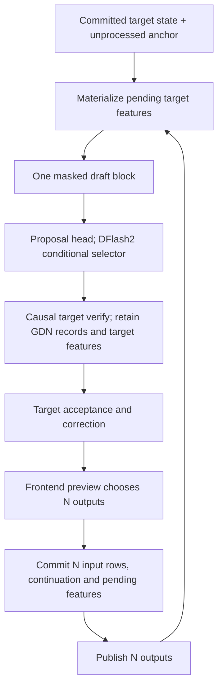

# DFlash and DFlash2

DFlash backends propose several tokens with one masked-block forward, conditioned on committed
target hidden features. The target verifies the proposal causally and remains the output authority.
NInfer implements DFlash and DFlash2 as optional components of the
[Qwen3.5 model](qwen3_5-model.md). Their private config and bindings select the stored weights;
startup chooses one backend, draft width and proposal head.

This reference owns model mathematics, proposal distributions and backend state. Scheduling,
publication and common transactions are defined by [Engine architecture](engine-architecture.md).

## Configuration and current geometries

Both draft configs use `model_type=qwen3` and identify `DFlashDraftModel` or `DFlash2DraftModel`.
They supply draft layer count, attention/FFN dimensions, norm epsilon, one-dimensional RoPE theta,
layer attention types, sliding window, target block IDs and mask token ID. DFlash2 also supplies
convolution tap/group dimensions and selector rank/top-k. The hidden width and embedding/output
semantics come from the target. Exact fields are parsed in
[`config.cpp`](../../src/models/qwen3_5/config.cpp).

| Quantity | Official 35B-A3B DFlash | Official 27B DFlash2 |
|---|---:|---:|
| Hidden width H | 2048 | 5120 |
| Draft layers | 6 | 5 |
| Intermediate width | 6144 | 17408 |
| Q heads / KV heads / head dimension | 32 / 8 / 128 | 32 / 8 / 128 |
| Target block IDs | `[1,6,11,16,22,27,32,37]` | `[5,19,33,47,61]` |
| Attention pattern | Five local layers, then one full layer | Five local layers |
| Sliding-window scalar S | 4096 | 2048 |
| Norm epsilon / RoPE theta | `1e-6` / `1e7` | `1e-6` / `1e7` |
| Dynamic convolution | — | Two taps, group width 16 |
| Candidate selector | Per-position argmax | Top-16 conditional path, rank 256 |

The current Engine accepts startup draft count K in `1..15` and concurrency B in `1..8`. The
physical block width is `W=K+1`, containing one anchor and K masks. K is a runtime choice, not a
weight dimension. Geometry representable in config still needs the actual native Op support;
for example, DFlash2's fused convolution, context materializer and selector implement the listed
27B geometry.

## Target conditioning and context

Let F be the target's processed-token frontier. The target has consumed positions `[0,F)` and
already selected the next token `a=x_F`, which is the unprocessed anchor. Before proposing, the
backend materializes any committed pending target features so its context also reaches F.

For each processed position t, let `r_t^l` be the complete residual output of zero-based target
block l, after both mixer and FFN residual additions. Conditioning is:

```text
s_t = concat(r_t^l for l in target_layer_ids, in recorded order)
c_t = plain_rmsnorm(W_feature s_t, context_norm)
plain_rmsnorm(x,w) = w * x / sqrt(mean(x^2) + eps)
```

The feature projection is bias-free. A hidden-state API that counts the embedding as boundary zero
would expose block l at boundary l+1; the stored IDs are block IDs. Features are captured before
the next block's input norm or final Text norm. Multimodal inputs use the same target residual
capture after Vision embedding replacement.

Each draft layer independently projects this common c_t into its context K/V:

```text
k_raw^l(t) = W_context_key^l c_t
k_ctx^l(t) = rope_1d(plain_head_rmsnorm(k_raw^l(t), key_norm^l), position=t)
v_ctx^l(t) = W_context_value^l c_t
```

Context prefill performs feature projection and these K/V projections. It does not run prompt
tokens through the draft residual/MLP stack. Context uses absolute scalar Text cache positions and
full-head split-half RoPE; it does not use the target's partial three-axis MRoPE.

Source K/V parameters are used for both query-block and context projections. Their logical roles
and Uses remain separate; the official recipes share compatible physical data. The representation
of one role can be selected independently of the other.

DFlash2's fused context materializer stores BF16 K and `FP16_RNE(BF16(v_raw))` V. Raw K has no
observable BF16 cast between projection and head normalization. This complete contract is in
[`context_kv_materialize.h`](../../include/ninfer/ops/context_kv_materialize.h). If a prefill chunk
exceeds the local ring capacity, only its final live window needs storage; the context frontier
still advances by the complete chunk.

## Query block and attention masks

The draft input is the target embedding of:

```text
absolute position   F       F+1       F+2       ...       F+K
input token         a       MASK      MASK                MASK
role                anchor  proposal  proposal            proposal
```

The anchor conditions the block but is not sampled from its draft output. Mask output i predicts
the token at the same absolute position, without the target causal LM's next-token shift. All
proposals come from this one forward.

Draft attention is non-causal over context and query-block K/V. For a local layer with scalar S:

```text
allowed(p_query, p_key) = abs(p_key - p_query) < S
```

Endpoints at distance S−1 are included; distance S is excluded. Populated sequence bounds clip
the symmetric interval. With a full left context and `p_query=F+i`, the row sees at most `S-1-i`
context positions, plus all W query rows for the supported widths. A full layer attends all
populated context and query rows. These masks are specified by
[`sliding_window_attention.h`](../../include/ninfer/ops/sliding_window_attention.h) and
[`softmax_attention.h`](../../include/ninfer/ops/softmax_attention.h).

## DFlash backbone and proposal

Each layer uses plain RMSNorm, full-head Q/K normalization and scalar RoPE:

```text
n = plain_rmsnorm(x, input_norm)
q = rope_1d(plain_head_rmsnorm(W_query n, query_norm), positions)
k = rope_1d(plain_head_rmsnorm(W_key n, key_norm), positions)
v = W_value n
a = attention(q, concat(K_ctx,k), concat(V_ctx,v), scale=1/sqrt(D), layer_mask)
y = x + W_output a
m = plain_rmsnorm(y, post_attention_norm)
x_next = y + W_down(SiLU(W_gate m) * (W_up m))
```

After final plain RMSNorm, the mask columns go through the selected proposal head. DFlash uses
per-column argmax, either over public vocabulary rows of the full Text head or over the indexed
proposal head followed by token-ID remapping. Thus its actual proposal q is a point mass, including
when target sampling uses positive temperature.

Changing W can change every proposal because attention is non-causal. A shorter block is not
required to match the prefix of a longer block.

## DFlash2 dynamic convolution

DFlash2 adds a dynamic grouped convolution around both attention and MLP. Each branch has input
and output sides, two taps and a group width of 16. For normalized branch input X, with
`X[b,i,g,j]`, `g=0..H/16-1`, `j=0..15`:

```text
delta = reshape(W_delta X, [B,W,2 sides,2 taps,H/16 groups])

Conv_s(X)[b,i,g,j]
  = (base[s,0,g,j] + delta[b,i,s,0,g]) * X[b,i,g,j]
  + 1{i>=1} * (base[s,1,g,j] + delta[b,i,s,1,g]) * X[b,i-1,g,j]
```

Base coefficients vary by channel; dynamic increments are shared by the 16 channels in a group.
Position zero has no preceding tap. The convolution has no history across requests or rounds.
The output side reuses the delta computed from that branch's normalized input, applying it to the
branch output rather than projecting delta again.

Each DFlash2 layer performs:

```text
n = plain_rmsnorm(x, input_norm)
(prepared_a, finish_delta_a) = attention_conv.prepare(n)
q, k, v = query_key_value(prepared_a)
q, k = plain_head_rmsnorm_and_rope(q, k, positions)
a = noncausal_attention(q, concat(K_ctx,k), concat(V_ctx,v), layer_mask)
y = x + attention_conv.finish(W_output a, finish_delta_a)

m = plain_rmsnorm(y, post_attention_norm)
(prepared_m, finish_delta_m) = mlp_conv.prepare(m)
z = W_down(SiLU(W_gate prepared_m) * (W_up prepared_m))
x_next = y + mlp_conv.finish(z, finish_delta_m)
```

The native fused prepare emits BF16 prepared input and BF16 finish delta. Internal normalized
input and projected coefficients are private intermediates; finish consumes the represented delta
from prepare. The contract is
[`dynamic_grouped_conv.h`](../../include/ninfer/ops/dynamic_grouped_conv.h). After all layers, final
plain RMSNorm produces mask hidden columns for the selector.

## DFlash2 candidate path

For each mask hidden h_i, the selected head produces stable top-16 unary scores u_i and global
token IDs C_i. An indexed proposal head remaps shortlist rows before codebook access. Unary top-16
selection does not apply target penalties, temperature or top-k/top-p/min-p.

Let predecessor/successor codebooks have shape `[vocab_size,R]` and the hidden projection have
shape `[R,H]`. The current selector receives its projected hidden g_i as BF16, candidate scores as
FP32 and codebooks as BF16. For predecessor candidate p and current candidate c:

```text
g_i = W_hidden h_i
pred_token(i,p) = anchor          if i=0
                  C_(i-1)[p]     otherwise
E_i[p,c] = u_i[c] + sum_r W_pred[pred_token(i,p),r] * g_i[r] * W_succ[C_i[c],r]
```

The path is a left-to-right conditional walk using the actual selected predecessor:

```text
temperature <= 0:
    j_i = lowest-rank argmax_c E_i[j_(i-1),c]
    q_i = one_hot(j_i)

temperature > 0:
    q_i[c] = softmax_c(E_i[j_(i-1),c] / temperature)
    j_i ~ q_i

d_(i+1) = C_i[j_i]
```

For i=0 every predecessor row refers to the anchor. This is a conditional walk, not global path
optimization. The Op retains the actual FP32 q_i and global candidate IDs for target correction.
It ignores other target sampling controls. The RNG key uses request seed, `F+i` and the distinct
DFlash2-proposal purpose; compact-batch row does not define random identity. Exact inputs,
tie-breaking and storage are in
[`candidate_selector.h`](../../include/ninfer/ops/candidate_selector.h).

## Target verification and committed prefix

For each request, let P be the number of proposals that can be verified this round, `0<=P<=K`,
and Q=P+1 the target's live input width. The physical allocation still has W columns:

```text
verify input       a       d_1     d_2       ...       d_P
input position     F       F+1     F+2                 F+P
target output      p_0     p_1     p_2                 p_P
predicts position  F+1     F+2     F+3                 F+P+1
```

Proposal d_(i+1) is checked against target p_i. Target distributions include the public vocabulary
mask and configured penalties/temperature/filters, with accepted proposal history added as the
scan advances. Greedy verification accepts the matching target-argmax prefix. At the first
mismatch it emits the target correction; all-accept emits the bonus from p_P.

For positive-temperature target sampling, use the actual proposal distribution:

```text
accept d_(i+1) with probability min(1, p_i[d_(i+1)] / q_i[d_(i+1)])
on rejection: r_i(v) = max(p_i(v) - q_i(v), 0)
              correction ~ r_i / sum_v r_i(v)
on all accept: bonus ~ p_P
```

DFlash q is one-hot; DFlash2 q is the retained conditional distribution. This preserves the
processed target distribution for the verify path. Different draft formats, shortlist heads or
block widths can change acceptance and throughput; their logits need not match one another.

### Live widths

The two backend implementations use different proposal extents near a request tail:

| Extent | DFlash | DFlash2 |
|---|---|---|
| Proposal attention/masked input | Q=P+1 live columns | All W=K+1 columns |
| Target attention and GDN | Q=P+1 live columns | Q=P+1 live columns |
| Candidate prefix checked | First P proposals | First P proposals with their actual q |

DFlash2 computes its configured W-column proposal even when only a prefix can be verified. Its
proposal-valid tensor and target-valid tensor have different meanings. Columns outside the
target live extent have no logical state effect. P=0 verifies only the anchor and selects a target
output.

### Publication and state alignment

If A proposals are accepted, target verification licenses
`y=[d_1,...,d_A,correction_or_bonus]`, with L=A+1 outputs. Frontend preview chooses the final prefix
length N, `0<=N<=L`, accounting for EOS, stop, budget and cancellation.

When N>0, the transaction commits N target input rows `[a,d_1,...,d_(N-1)]` and publishes N output
tokens `[y_1,...,y_N]`. Continuation hidden comes from verify column N−1, and y_N becomes the next
unprocessed anchor. Target KV, GDN Fold, generated-token counters and frontier advance together.
The Fold uses records from this physical verify block, not a separately recomputed numerical path.

The first N columns of captured target features become pending context work. Context may remain at
F while target state advances to F+N. Before the next proposal, or before retaining a checkpoint,
fork or Host replica, those features are materialized and context catches up. N=0 cancellation
commits no new state and releases the sequence; it does not undo earlier adopted commits.

## Open items register

Work this tree has decided not to finish yet, with the measurement that says why. Every entry is
"known unfinished", not "known good".

**Verify rectangle columns 1..K (closed 2026-11-15: the collapse was a dump bug).** Every rate this
document records for a column >= 1 before 2026-11-15 is void. `NINFER_DFLASH2_DUMP` sorted a
full-vocabulary index vector and then shrank it to sixteen (`order.resize(kTop)`, `draft.cpp:1245`),
so from column 1 on, `argmax`, the top-16 list, `overlap` and `unary_rank` all described a
sixteen-token vocabulary - which is exactly why column 1 read 0.0% in every round, why its "top-1
logit" was 9.2 against column 0's 25.1, and why columns 2..7 looked like noise. The vector now keeps
its full length and the top-k is a copy; the same run reports the marginal-predictor decay the design
predicts:

| column | 0 | 1 | 2 | 3 | 4 | 5 | 6 |
|---|---:|---:|---:|---:|---:|---:|---:|
| selector_hit (pick == target argmax) | 51.6% | 38.7% | 22.6% | 16.1% | 16.1% | 19.4% | 25.8% |
| top-16 recall (argmax inside the candidates) | 93.5% | 74.2% | 54.8% | 32.3% | 54.8% | 48.4% | 45.2% |
| top-1 logit | 20.9 | 20.5 | 18.2 | 17.9 | 16.2 | 16.2 | 14.6 |
| nested (rounds accepting at least this many) | 16 | 7 | 4 | 2 | 2 | 2 | 1 |

v5_e2, greedy, `--no-cuda-graph -pg 64,64 --spec dflash2 --draft-tokens 7 --warmup 0 -r 1`, 31 rounds,
217 drafted columns. The engine's own `accepted_per_position` is `[16, 6, 4, 2, 2, 2, 1]`: one round
apart, and that round is a target argmax tie.

Everything below that quotes a rate for a column >= 1 is void for the same reason. The mask, ring,
ladder and selector conclusions underneath still stand, but on the k=1 acceptance experiments and on
column 0, which the bug never touched - not on a column-1 cliff, because there was none: the decay from
column 0 to column 6 is 51.6% -> 25.8% with recall 93.5% -> 45.2%, i.e. a marginal predictor, which is
what `core/dflash2.hpp:148-150` describes.

Two things are ruled out by measurement rather than argument. The columns are addressed correctly:
`NINFER_DFLASH2_DUMP` shows cache and RoPE positions stepping `F, F+1, ... F+7` and each column's
first residual words at O(1), so neither a broadcast column nor a wrong position is the cause. And
the sparse indexer is not the cause: `NINFER_QSA_FORCE_FULL=1` (the dense arm, a different mixer for
every indexed layer) moves nothing while column 0 stays at 73.9/30.4%.

A per-column magnitude probe (`NINFER_VERIFY_COLUMN_PROBE`, `verify_probe.h`) adds a third exclusion:
the rectangle's state is carried, column by column. On the same artifact the GDN recurrence, the
attention mixer and the final fold all report ordinary per-column magnitudes - GDN output 0.0111 /
0.0115 / 0.0111 / ... / 0.0116, attention output 0.0713 / 0.0676 / 0.0647 / ... / 0.0668, final fold
4.31 / 3.79 / 3.41 / ... / 3.30 - so no column is reading a state that never advanced.

The draft block is the remaining suspect, and its mask was tried: `draft.cpp:455` gives every column
the same `valid_columns = width` and `positions = F + i`, and the op takes one shared visible end for
the whole block (`sliding_window/launch.cu:60` passes `positions[0]`, `kernel.cuh:95` reads
`length = positions[0]`, then tiles only `[0, length)`). That end is `F`, so the anchor at `F` is
outside every draft column's key set. Admitting it by moving the end to `F + 1` was implemented,
measured and reverted: the proposal collapsed instead of improving - the first candidate became token
0 in most rounds, column 0's agreement with the target argmax fell from 90% to 0.0%, and k=4 acceptance
went from 33.7% to 0 - because this op reads only the committed context ring (`kernel.cuh:21-33`, no
append, key set `[length - window, length)`), and the drafter's ring ends at `F - 1`: the slot at `F`
holds whatever position `F - window` left there. Making the anchor visible therefore needs the anchor's
row appended to the draft context first (the `context_frontiers` to `frontiers` bookkeeping in
`program/decode.cpp:842`), not a change to the visible end.

That next step was checked against the append accounting before writing it, and the accounting closes
the entry instead: `prepare_ragged_prefix_kernel:21,32` appends `[starts, ends)` with `ends` the
execution frontier and writes `positions = starts + column`, so the draft ring covers `[0, F)` and its
last committed row is position `F-1` - the anchor itself. The key set is `[length - window, length)`
with `length = positions[0] = F` (`kernel.cuh:95,104`), so **every draft column already sees the
anchor's row at `F-1`**, and the block's own rows are simply not part of that ring. Appending the
feature at `F` would duplicate the row at `F-1` and desync the frontier bookkeeping, and `+1` would
then read a slot no pass ever wrote - which is the failure that was measured (acceptance 33.7% to 0,
first candidate token 0). The masked-row mask is therefore not the open item: DFlash2's masked rows are
trained not to see each other, and they already see the anchor and the context. What is still open is
what the *draft head* does with a masked row's state, which needs a comparison against the draft's own
teacher conditioning rather than another change to this rectangle.

That was probed too, and the probe cannot answer it: `NINFER_DFLASH2_ROW_PROBE` prints the head's
per-row input after `rmsnorm_pack_tail` - 3.58 / 3.59 / 3.53 / 3.50 / 3.50 / 3.51 / 3.50 / 3.50 across
the eight masked rows - and a final norm sets that magnitude by construction, so it says nothing about
whether the rows are the same class. What the probe does confirm: `mask_token_id = 248077`,
`selector_top_k = 16`, `selector_rank = 256`, and the head runs on `k` columns with one row per masked
slot (`draft.cpp:484-488`, `hidden` is `{hidden_size, k}`), so no row is shared and no column reads
another's row.

Combined with the behavioural record - column 0 at 51.6% of the target's own argmax, columns 1..6 at
16-39% (corrected table above), and the k ladder measuring acc 0.5500 at k=1 down to 0.1217 at k=7 - the
honest reading is that DFlash2 in this tree is a marginal predictor whose useful width is set by
throughput, not by a broken column. An earlier version of this entry concluded "effectively k = 1"
from column 1 reading 0.0%; that reading was the dump bug and the conclusion is withdrawn. Accepted run
length never exceeds one token in the pre-fix dumps (histogram `0:10, 1:25` over 35 rounds); the fixed
dump's nested survival is `[16, 7, 4, 2, 2, 2, 1]`, so longer windows do accept, just rarely.

**Block-causal two-pass (superseded, kept for the numbers).** The entry below implements the
ring-only form the reference actually has; everything here was measured against the causal and
replay variants before that. The fix the masked-row record pointed at - let each
column see the block rows before it instead of its siblings' shared input - is implemented end to end
and moves nothing. The op gained a block tile (`block_key`/`block_value`/`block_width` at
`include/ninfer/ops/sliding_window_attention.h`, staged by `context_query_stage_block_tile` in
`src/ops/softmax_attention/common/context_query.cuh`, consumed as a trailing iteration owned by the
last split), the query tile was put under the same `key < query` bound, and `draft.cpp` runs the
stack twice: the first pass with committed context alone in view and leaves its per-layer K/V in the
planes, the second admits those rows causally.

Three probes (`NINFER_DFLASH2_BLOCK_PROBE`, off by default) settle where the mechanism actually
stands, on v5_e2 at frontier 64 with `--draft-tokens 8`:

- *Staging row*: the block tile stages `block_width` rows, row `r` reads plane column `r` at
  `positions[r]`. With `block_width=2` it stages `row=0 pos=64 k=[0.37109 0.17090 0.87500 -0.94531]`
  and `row=1 pos=65 k=[1.51562 1.30469 1.65625 -0.41992]` - the two rows the one-pass run produced for
  those columns, and different from each other. Not a fixed row.
- *Plane writes*: after the last pass the plane reads back nine columns at positions `F..F+8`, each
  with its own K (e.g. cols 0..3 `[-0.09473 0.43750 1.10156 -0.37109]`,
  `[0.30859 1.07812 1.04688 -0.29883]`, `[0.12793 0.29297 2.31250 0.95312]`,
  `[-1.61719 -0.32031 1.73438 0.10596]`). The width dimension is written per column, so the columns
  differ by position and by state, exactly as the design says.
- *Visible set*: the block-internal key tally per query column is `[0,1,2,3,4,5,6,7,8]` for every
  pass and every layer - column `j` is offered exactly `j` block keys, never 0 across the board.

So none of the three is broken, and the second pass still buys nothing. `accepted_per_position` on
v5_e2, `pp64+tg32 --warmup 1 -r 1 --no-cuda-graph` (deterministic; repeats are identical):

| draft width | stack runs | acceptance | accepted per position | decode |
|---|---:|---:|---|---:|
| K=4 | 1, no bound (before) | 0.1806 / 1.72 | 8, 4, 1, 0 over 18 rounds | 2.83 |
| K=4 | 1, causal | 0.1622 / 1.63 | 8, 4, 0, 0 over 19 rounds | 2.29 |
| K=4 | 2, causal + plane | 0.1622 / 1.63 | identical | 2.45 |
| K=4 | 3, causal + plane | 0.1622 / 1.63 | identical | 2.62 |
| K=8 | 1, no bound (before) | 0.0542 / 1.39 | 8, 1, 0, ... over 23 rounds | 2.33 |
| K=8 | 1, causal | 0.0563 / 1.41 | 7, 2, 0, ... over 22 rounds | 1.92 |
| K=8 | 2, causal + plane | 0.0563 / 1.41 | identical | 2.06 |
| K=8 | 3, causal + plane | 0.0563 / 1.41 | identical | 2.04 |

The planes are not a no-op to the last bit - the head's input per column moves in the fourth digit
(`draft-head-in` c1 3.7007 with one run against 3.7011 with two, c4 3.5734 against 3.5790) because the
same row arrives from a different tile and the softmax accumulates in a different order - but the keys
they add are rows the same pass already had, so the acceptance cannot move. The probes also correct
the earlier reading of this table: what an earlier revision of this entry called "passes" was the
number of stack runs, and a two-run form is one causal pass plus one replay, not two independent
estimates.

The gates are unchanged under all of it: v5_e2 20.394196, 35B 20.205381. Decode cannot price the
extra runs today (no-spec decode 8.38 tok/s against the 24-25 on record, so the box is disk-bound),
but the runs-vs-runs figures above are same-session and say a replay costs 10% at K=8 for nothing,
so the next revision should default the stack to a single causal pass (`draft.cpp:495`, `return 2`
to `return 1`).

**Per-row RoPE is not the gap either (probed).** The identical `prepared` columns are the
dynamic-convolution output, which is *before* RoPE, so they say nothing about the rotation - exactly as
the reference has it. `NINFER_DFLASH2_ROPE_PROBE` (`draft.cpp:414`, off by default) prints what
`ops::rmsnorm_rope` (`draft.cpp:652`) receives and returns, on the first draft layer. The positions
tensor is per column, not per request: shape `[9,1,1,1]`, `nb=[4,36]`, values `64..72` at
`--draft-tokens 8` and `[5,1,1,1]`, `nb=[4,20]`, values `64..68` at `--draft-tokens 4` - anchor at
`F`, masks at `F+1..F+K`, which is the reference's `pos0+1 .. pos0+7`. What comes back is rotated per
column, with the first four components of head 0 of `k` reading

  col 0 `[0.37109 0.17090 0.87500 -0.94531]`   col 1 `[1.51562 1.30469 1.65625 -0.41992]`
  col 2 `[1.41406 0.13770 1.23438 -1.22656]`   col 3 `[-0.43750 -0.45703 -0.42969 -1.43750]`

and column RMS `1.28016 / 1.28502 / 1.27651 / 1.27665 / ...` for `k`, `1.30472 / 1.28840 / 1.30589 /
...` for `q`. Equal norms, different components: the columns carry one content in different
rotations, which is the design. So neither `prepare_masked_block` nor `rmsnorm_rope` is mis-shaped,
and the "every masked column is one row" reading is closed on the RoPE side as well as on the K/V
side.

What the reference does *not* do, and this tree still does, is admit block rows as keys at all: Strata's
attention reads the ring only, so no block row sees the anchor or its siblings. Here the partial body
lets the query tile admit its whole self - `current_is_query` with `col >= query_first_row` at
`src/ops/softmax_attention/common/context_query.cuh:469,483-490` (causal since the bound landed,
unconditional before it). That is one mask expression, identical for every column, which is what makes
the columns agree; it is the next candidate and not this round's change.

What that leaves is the one input the block never has: the token each column *selected*. The planes
carry the mask row's own state for every column, so conditioning needs the head's output fed back -
after `ops::candidate_selector_path` (`draft.cpp:777`) walk one column per pass, embedding the
previous column's `draft_tokens` value in place of the mask id (`prepare_masked_block` at
`draft.cpp:572`, rows `1..k`), which costs one stack pass per column and is the only remaining
mechanism that can make a column differ from its siblings.

**Block visibility: the reference keeps the block's own keys (corrected here).** The tree's ring-only
form was a misreading of a paraphrase. The reference file says the opposite in two places:
`core/dflash2.hpp:10` reads "attention over the ring + the block's own keys", and
`kernels/dflash2.hpp:43-45` spells the mask out - "Row i at position s + i sees context position j when
s + i - j < window ... and every block key". The block's keys stay outside the ring (so a rejected
draft leaves nothing to roll back, `core/dflash2.hpp:14-15`), but every block row sees all of them,
including itself and the rows after it. That is what the op does again: the query tile bypasses the
position bound (`context_query.cuh:466,481-487`), and `block_causal` is back to bounding context keys
only. Measured on v5_e2, `pp64+tg32 --warmup 1 -r 1 --no-cuda-graph`, accepted_per_position:

| draft width | block keys | acceptance | accepted per position | decode |
|---|---|---:|---|---:|
| K=4 | visible (reference, now) | 0.1806 / 1.72 | 8, 4, 1, 0 over 18 rounds | 2.81 |
| K=4 | causal (two rounds ago) | 0.1622 / 1.63 | 8, 4, 0, 0 over 19 rounds | 2.29 |
| K=4 | ring only (previous round) | 0.1644 / 1.63 | 8, 4, 0, 0 over 19 rounds | 2.46 |
| K=7 | visible (reference, now) | 0.1217 / 1.82 | 9, 4, 1, 0, ... over 17 rounds | 1.84 |
| K=7 | ring only (previous round) | 0.0968 / 1.63 | 8, 4, 0, 0, ... over 19 rounds | 1.91 |
| K=8 (clamped to 7) | visible | 0.0968 / 1.63 | 8, 4, 0, ... over 19 rounds | 1.71 |

The clamp is the reference's own shape: `core/dflash2.hpp:39-40` fixes the block at `kRows = 8` and
`kDrafts = kRows - 1 = 7`, and `kernels/dflash2.hpp:14,19` sizes the attention ring for 8 block keys,
so a ninth column cannot exist. `draft_cap.hpp:21-25` caps the *verify window* per card class (0 on a
4090, "--spec as given"), which is a different number from the block's row count. Any request wider
than seven is clamped at plan time (`startup.cpp:1185-1203`, used at `:1246`) with one line on stderr.

Width and the block's keys together are what moved column 2: at `--draft-tokens 7` with the block's
keys visible, the walk is `[9,4,1,0,0,0,0]` over 17 rounds - column 2 accepts for the first time in
any configuration measured so far, against 0 in every ring-only or causal run.

Feeding each column its predecessor's *selected* token into the block input was tried and is worse:
at K=7 the walk went from `[8,4,0,...]` / 0.0968 to `[10,1,0,...]` / 0.0840, and at K=4 from
`[8,4,0,0]` / 0.1644 to `[10,1,0,0]` / 0.1410. The reference does condition per column, but through
the selector walk (`kernels/dflash2.hpp:96-102`, `df2_select`: unary plus a bilinear score between
the previous pick and each candidate), not through the model input, and the mask rows keep the mask
embedding. The experiment was removed.

The dynamic convolution is the last piece of the layer the block rows could differ through, and it is
correct. `NINFER_DFLASH2_CONV_PROBE` (`draft.cpp:468`) prints the Op's input and output per column for
the first draft layer: `base_kernel` is `[2560,2,2]` with `kernel_projection` `[640,2560]`, and head 0
reads tap0/tap1 `1.01562/1.09375` on side 0, `0.95703/0.99219` on side 1. The `in` residual is
`col0 rms 0.00167`, `col1..col8 rms 0.00519` with identical components (one mask embedding), and the
`out` is `col0 6.58507`, `col1 0.64240`, `col2..col8 0.46942` with identical components. So column 1
consumes the anchor's normalized input through the second tap - the only column that can - and
columns 2..8 consume the masked row before them, which is the same row they are. That is exactly the
Op's documented form, `(base[h,0,s]+d[0,s])*n[h,i] + I(i>0)*(base[h,1,s]+d[1,s])*n[h,i-1]`.

The convolution matches the reference exactly, including row 0: `kernels/dflash2.hpp:24-25` defines
`out[b][c] = sum_{o < 2, b - o >= 0} (base[o][c] + dyn[...]) * x[(b - o) * H + c]`, so row 0 also has
a single tap there, and the reference's remark about an accepted row's taps arriving after the verify
window (`core/dflash2.hpp:14`) is about the ring's rows being written late, not about the block's
formula. The same line is what our Op documents as `I(i>0)`.

Checked against the reference file, the rest of the draft layer matches: one shared mask token for
every masked row (`prepare_masked_block`, `draft.cpp:572`), norm then two-tap conv then q/k/v then q/k
norm and rope (one call, `draft.cpp:652`), attention over the ring plus the block's own keys, and a
head that reads the masked columns alone (`kernels/dflash2.hpp:12`: "final norm -> head over the draft
vocabulary (rows 1..7) -> top-16 -> walk"). What is still different is on the verify side, not the
draft layer: the reference accepts a draft only when it equals the target's pick from the *same*
uniform draw (`coupled_draft.hpp:3-12`, `STRATA_SPEC_COUPLED`), while this tree compares against the
target's argmax; under greedy the two agree (`verify.hpp:8`: "a draft is accepted exactly when greedy
decode would have produced it"), so the difference only bites when sampling. The reference also stages
`set_spec_proposal` for that path (`verify.hpp:184`). `draft_cap.hpp`'s per-card cap is a verify-window
recommendation, not a block shape, and is 0 on this card.

**Point-by-point against the reference sources (all eleven match).** Read against the cloned tree at
`H:\TeleAgentWorks\.temp\strata-official`, the draft half now matches on every point that can be
checked from code:

| point | reference | here | same |
|---|---|---|---|
| block rows / anchor position | `src/core/dflash2.cpp:1033-1038`: `h_meta_[8+i] = s+i`, `s = pos0+n_new`, `h_meta_[17] = s`, tokens `[anchor, mask x7]` | `prepare_masked_block.cuh:17-18`: `ids[0]=anchor`, else mask, `positions[i] = lengths + i`; `draft.cpp:572` | yes |
| mask embedding | `src/core/dflash2.cpp:1038` (`mask_token_` for rows 1..7) + `:471` `embed_(d_meta_+24, 8)` | `prepare_masked_block.cuh:17` + `draft.cpp:588` `ops::embedding` | yes |
| conv taps | `kernels/cuda/dflash2.cu` `df2_conv` doc `kernels/dflash2.hpp:24-25`: `sum_{o<2, b-o>=0}(base[o][c]+dyn[..])*x[(b-o)*H+c]`; called on `xn_` with `base_a` / `base_a+2N` (`src/core/dflash2.cpp:485,496,500,510`) | `prepare` op `include/ninfer/ops/dynamic_grouped_conv.h:37-40` same form; `draft.cpp:580` + `finish_dynamic_branch` | yes |
| q/k/v + norm | `src/core/dflash2.cpp:487,489`: `q_proj,k_proj,v_proj` on the conv output, `df2_norm_rope_qk(q,k,q_norm,k_norm,...)`, v untouched | `draft.cpp:534` `attn_input_proj`, `:652` `rmsnorm_rope(positions, q_norm, k_norm, q, k, theta)`; `rmsnorm_rope.h:11-19` plain per-head norm, `weight` (not `1+weight`) | yes |
| RoPE | `kernels/dflash2.hpp:29-35`: table from `d_meta_+8` (block positions `s+i`), neox/rotate_half, `theta^(-2i/128)` | `rmsnorm_rope.h:19-23`, positions = `proposal_positions` (F..F+k, measured last round) | yes |
| attention | `kernels/cuda/dflash2.cu:131-134,159-167`: `lo = s-(window-1)`, `nctx = s-lo`, then `nkeys = nctx + kDf2Rows` with block row `k-nctx`; mask `(lo+k) > (s+row-window)` for context only, **every block key**; `scale = rsqrtf(HD)` (`:142`) | `context_query.cuh:466,481-487` (query tile bypasses the bound, context admits `key >= query-(window-1)`), `draft.cpp:607` scale `1/sqrt(head_dim)` | yes |
| residual / norm order | `src/core/dflash2.cpp:496,510`: `h_ += conv(o_)` then `rms(h_)`, same for the MLP, last layer norm = `norm.weight` into `fn_` | `finish_dynamic_branch` (`draft.cpp:625`) adds into `residual`; next `prepare` norms it; `rmsnorm_pack_tail(residual, final_norm, ...)` `draft.cpp:713` | yes |
| head input | `src/core/dflash2.cpp:513`: `native_quantize_q8_1(fn_ + N_, ..., ndraft_)` - rows 1..7 only, already final-normalized | `rmsnorm_pack_tail` (`rmsnorm_pack_tail.h:25-27`: anchor rows outside the computation, `weight` gain) | yes |
| selector walk | `kernels/cuda/dflash2.cu:861-896`: `prev = *anchor_tok`; `vp = pred_cb[prev*rank+t]*hp[i*rank+t]`; `sc[j] = unary + dot(succ_cb[tok_j], vp)`; argmax, ties to lower; `prev = out_tok[i]` | `candidate_selector_path.cu:96,73-88,105-112`: identical, with `draw_rank` reducing to that argmax at `temperature <= 0` (`:41-46`) | yes |
| verify | `core/verify.hpp:8`: greedy accepts iff the target's top-1 is the draft; `coupled_draft.hpp:3-12` couples sampling by one uniform | `speculative_round.cuh:153-154` greedy `dist_idx[lane][0] != d`; sampling uses the ratio test | greedy yes, sampling differs |
| width | `core/dflash2.hpp:39-40`: `kRows=8`, `kDrafts=7`; `kernels/dflash2.hpp:14,19` | `startup.cpp:1185-1203` clamp to 7 (landed last round) | yes |

Measured acceptance across widths on v5_e2 (`pp64+tg32 --warmup 1`, accepted_per_position):

| k | 1 | 2 | 3 | 4 | 5 | 6 | 7 |
|---|---:|---:|---:|---:|---:|---:|---:|
| acc | 0.5500 | 0.3514 | 0.2407 | 0.1806 | 0.1461 | 0.1400 | 0.1217 |
| per position | 11 | 9,4 | 8,4,1 | 8,4,1,0 | 8,4,1,0,0 | 9,4,1,0,0,0 | 9,4,1,0,0,0,0 |

Column 0 lands at 55-45% and column 1 at ~21%, then ~6%, then zero: a marginal-predictor decay, which
is what the design is - `core/dflash2.hpp:148-150` says "every row is its own column, the walk goes
left to right", so only the selector carries the chain between columns. Nothing in the draft half is
left to align.

The verify side's coupled acceptance is implemented too, and it measures worse here:
`NINFER_COUPLED_DRAFT` makes the draft and the target share one uniform per row (counter = the row's
absolute position, `coupled_draft.hpp:3-12`), so a draft is kept only when it equals the target's own
pick (`speculative_round.cuh:197`, `coupled_target_pick` at `:183`). On v5_e2 at `--sampling-preset
community` (temperature 0.6) that gives acceptance 0.0435 with `[6,1,0,...]` and 161 drafts over 25
rounds, against 0.0719 with `[5,4,1,0,...]` and 139 drafts over 21 rounds for the classic ratio test -
exact match is simply stricter than a probability ratio when the draft's sixteen candidates and the
target's full distribution differ. It is therefore off by default (the ratio test is untouched, and
greedy never enters either branch), and the only other numeric difference left is that the reference
runs the block on q8 activations where this tree keeps BF16.

**Selector hit against candidate recall (probed).** `NINFER_DFLASH2_DUMP` appends two booleans per
(round, column): `selector_hit`, the selector's pick equals the target's argmax at that column, and
`topk_recall`, that argmax is inside the column's sixteen candidates at all. They separate a badly
ranked candidate set from a badly ranked pick. The dump is deterministic to the bit - two runs of the
same command produce files with the same SHA-256 - so these are not sampling artefacts.
`--spec dflash2 --draft-tokens 7`, 31 rounds: the table is the corrected one at the top of this
register (51.6 / 38.7 / 22.6 / 16.1 / 16.1 / 19.4 / 25.8 for hit, 93.5 / 74.2 / 54.8 / 32.3 / 54.8 /
48.4 / 45.2 for recall). The values this section carried before 2026-11-15 (column 1 at 0.0%) were the
`order.resize` bug, not the model.

Column 0 is a *ranking* failure, not a candidate failure: the answer is among the sixteen in 93.5% of
rounds and the selector converts 51.6 of them, i.e. the unary+edge score loses about forty points
against its own candidate set. Columns 1..6 are both: recall falls to 32-74% and the hit to 16-39%, so
part of the loss is the right token never being a candidate. The decay from column 0 to column 6 is the
marginal-predictor decay of a block whose rows are independent columns and whose only link is the walk
(`core/dflash2.hpp:148-150`), spread over six columns rather than concentrated at column 1.

`unary` is the head's raw score on both sides: `linear_topk` returns `s_{v,t} = sum_k
dequant(head)_{v,k} * hidden_{k,t}` with no softmax or temperature (`linear_topk.h:32-35`), the
selector adds it to the edge dot product unchanged (`candidate_selector_path.cu:87`), and the
reference's `df2_topk` hands the walk its top-16 **logits** the same way (`kernels/dflash2.hpp:93-102`,
used at `src/core/dflash2.cpp:532`). No change was needed there.

**What the edge term actually corrects (measured), and the BF16-draft question.** Column 0 splits the
selector's contribution exactly: the head's own top-16 argmax equals the target's argmax in 14 of 31
rounds (45.2%), the selector's pick does in 16 (51.6%), and on the 17 rounds the head was wrong the
correct token was still among the sixteen in 15 of them - of which the edge term fixed 2, i.e. 13.3%
of the fixable mistakes (58-round repeat: 3 of 23, 13.0%). So the +6.4 points are a real but weak
correction, not just stability, and the remaining ~42 points sit in the head's own ranking.

That bounds what a BF16 draft head could buy, and the cost of finding out is asymmetric. The recipe
pins every `dflash2/*` projection to Q8 except the ones it leaves alone (`kernel_projection`,
`candidate_selector/hidden_projection`, `tools/convert/official_recipes.py:35-50`), so a BF16 draft
needs a BF16 route for five op families:

| op | current | BF16 route needed | reuse |
|---|---|---|---|
| `linear_topk` (head) | Q8_G32_FP16 or FP8 only (`include/ninfer/ops/linear_topk.h:28-29`) | new profile over BF16 weights | `ops::linear` has registered contiguous BF16 problems (`linear.h:72-74`); `logits_topk_softmax` gives top-k but softmaxed |
| `linear_swiglu` (mlp gate/up) | Q8/FP8/NVFP4 profiles (`linear_swiglu.h:50-53`) | new profile | `linear_pair` + `silu_mul` compose it |
| `attn_input_proj` (q/k/v) | BF16 profile exists for the target shape `[14336,5120]` only (`attn_input_proj.h:62-65`) | register the draft geometry (N=5120, no gate) | three `ops::linear` calls |
| `dynamic_grouped_conv_add` (o_proj/down/fc finish) | projection is Q8_G32_FP16 RowSplit (`dynamic_grouped_conv.h:95-96`) | new profile | the prepare side is already BF16 (`:44-46`) |
| `ops::linear` (o_proj, down, fc) | BF16 registered | none | - |

That is five op-level contracts, each carrying this repo's oracle, numerical criterion and profile
registry - weeks, not hours. The cheap slice that actually tests the hypothesis is the *head alone*
(`ops::linear` into a logits tensor plus a top-k): days. Given that column 0 is limited by the head's
ranking against the target's argmax - a distribution disagreement, not a 1e-3 numerics gap - the
recommendation is to do the head-only A/B if anything, and not to rebuild the whole draft in BF16.

**Raising `selector_top_k` past 16 (assessed, not done).** The config path is already dynamic - the
artifact's `selector_top_k` reaches `DraftConfig` (`config.cpp:313,337`) and the plan sizes the score
matrix and candidates from it (`draft.cpp:757-794`, `startup.cpp:869`) - but five consumers pin the
number to sixteen at compile time or in a buffer shape:

| site | what pins 16 |
|---|---|
| `src/ops/linear_topk/linear_topk_workspace.h:10` | `kLinearTopK = 16`: the op's contract is `[16,U]` output, and its merge kernel tiles by 16 |
| `src/ops/candidate_selector/bf16/candidate_selector_path.cu:11` | `kCandidates = 16` |
| `.../candidate_selector_path.cu:85,97,183` | `score_row` uses `warp = tid>>5` **as the candidate index**, and the walk launches 512 threads (16 warps) with `__launch_bounds__(512,1)`; 24/32 candidates need 768/1024 threads and a templated block size |
| `src/ops/kernel/speculative_round.cuh:18` + `src/ops/wrapper/speculative_round.cpp:17` | `kSparseSpeculativeCandidates = 16`: the accept path's `proposal_q` width and `speculative_sparse_probability` loop |
| `src/models/qwen3_5/program/round_buffers.cpp:175-180` (and the DFlash sibling at `:221`) | `candidate_ids`/`proposal_q` allocated `{16, columns-1, batch}` |

Cost: each op carries this repo's oracle, numerical criterion and profile registry, so `linear_topk`
plus `candidate_selector` template instances plus the sparse accept is roughly one to two weeks.
Payoff bound: recall at column 0 is already 93.5% at top-16, so a wider candidate set can add at most
6.5 points of recall, and the selector converts only 13% of its fixable mistakes into hits - the
expected column-0 gain is a few points, i.e. far below the 42-point ranking gap. Recommendation: leave
the candidate count alone; the lever is the head's ranking, not the width.

**Why column 0 stops at 45-52% (measured rank distribution).** The dump now also records where the
draft's own top candidate lands in the target's FULL distribution and its logit distance from the
target's argmax. Over 31 rounds at `--draft-tokens 7`, column 0 reads: rank 1 in 14 rounds (45.2%),
rank 2 in 8 (25.8%), rank 3 in 2 (6.5%), rank 4-8 in 1 (3.2%), rank 9-16 in 0, rank >16 in 6 (19.4%).
On the 17 wrong rounds the split is 8 at rank 2 (47.1%), 2 at rank 3, 1 at rank 4-8 and 6 beyond 16
(35.3%), with a logit gap to the target's argmax of median 2.63 and p90 17.3 (0.50 / 4.38 over all
rounds). So most failures are near-ties - the draft's top token is the target's runner-up, a couple of
logits away - and the rest is deep disagreement. The two heads are not far apart in the large: the
draft's sixteen candidates share 6.9 ids with the target's top sixteen on average, and no round had an
empty intersection, which is why recall sits at 93.5%.

Reading: the 45.2% is a *head ranking* limit, not a candidate or layer limit. The selector converts
13% of the fixable mistakes (measured earlier), widening the candidate set can add at most 6.5 recall
points, and the near-tie mass (59% of errors within rank 3) is a precision/calibration question between
two heads - the draft's Q8 head and the target's Q5 head. What would settle how much is head versus
layer is running the target head on the draft's own hidden row: `linear_topk` already registers Q5 with
the full head (`src/ops/linear_topk/linear_topk.cpp:48`), so it is one extra launch per round behind an
env switch, but this session measured only the rank distribution above.

**Dynamic-threshold draft tree (assessed offline, not implemented).** The question was whether keeping
candidates by a cumulative score threshold - a tree whose width is decided per column instead of a
fixed top-k - recovers enough acceptance to pay for the extra verified tokens. It is answered from the
selector's own scores rather than by building the tree, because the scores decide it.

Scores: no dump carried them (candidate ids alone cannot price a branch: "the right token was rank 3"
says nothing about how many tokens a tree must verify to keep it). `NINFER_SELECTOR_EDGE_PROBE` now
makes the lattice route keep its `(column, predecessor rank)` score lattice - the route already builds
all 16x16 of it for `K > 4` and reads only the diagonal - and `NINFER_DFLASH2_EDGE_DUMP` writes it as
`step,column,rank,argmax,ids[16],edge[16]`. Both are off by default; the buffer is 120 KiB, allocated
once, and a direct-route (K<=4) launch clears it instead of leaving a stale lattice. The simulation
(`H:\TeleAgentWorks\.temp\tree_sim.py`) keeps, per column, the score-sorted candidates until their
softmax mass reaches tau, walks the resulting tree with an exact node-count DP (nodes are what the
target verifies and what the expert union sees), and scores acceptance against the target argmax the
single-chain verify wrote at that column - so an untaken branch inherits the chain's distribution and
its acceptance is an upper bound. The chain row of the same simulation reproduces the engine: 0.1567 /
2.0968 against 0.1579 / 2.0645.

| tau | branches per column 0..6 | nodes/round | paths/round | acc | len | cost vs chain |
|---:|---|---:|---:|---:|---:|---:|
| 0.5 | 1.61 1.45 1.40 1.65 1.66 1.46 1.56 | 85.8 | 38.0 | 0.2120 | 2.484 | 10.7x |
| 0.6 | 2.03 1.74 1.77 1.83 1.91 1.89 1.84 | 343.7 | 188.6 | 0.2350 | 2.645 | 43.0x |
| 0.7 | 2.52 2.27 2.13 2.14 2.31 2.40 2.12 | 1545.1 | 991.7 | 0.2442 | 2.710 | 193x |
| 0.8 | 3.32 2.84 2.85 2.90 3.03 3.04 2.80 | 9156.1 | 6639.0 | 0.2765 | 2.935 | 1145x |
| 0.9 | 4.65 4.14 4.22 4.01 4.24 4.19 4.07 | 100117 | 80313 | 0.2903 | 3.032 | 12515x |

Cost is the number of tree nodes over the 8-row chain, because a tree is verified in full whether or
not its branches were right. The gain is real and front-loaded (tau 0.5 buys +5.5 points of acceptance
for 10.7x the verify rows) and the cost is the product of the per-column widths, not their sum, so
every tau below 0.9 is already dead. Two smaller shapes were priced to be sure the number is not an
artefact of branching everywhere:

| shape | nodes/round | acc | cost | speed |
|---|---:|---:|---:|---:|
| branch at columns 0-1 only, tau 0.5 | 16.7 | 0.1889 | 2.09x | 0.53 |
| branch at column 0 only, tau 0.5 | 12.3 | 0.1843 | 1.54x | 0.71 |
| gate: column 0 keeps two only when p(top-1) < 0.4 | 9.8 | 0.1705 | 1.23x | 0.85 |
| k=3 window, column 0 only, tau 0.5 | 5.8 | 0.3548 | 1.46x | 0.76 |
| ceiling: all 16 kept at every column | 2.9e8 | 0.3825 | 3.6e7x | 0.00 |

`speed` is `(len / 2.0968) / cost`, i.e. tokens per unit of verify work; it is below 1 everywhere and
the best row (the gate) is 0.85. The ceiling is the structural reason: even keeping all sixteen at every
column reaches only 38.25% acceptance, because from column 1 on the target's argmax is often not in the
candidate set at all (recall 32-74%). So the branching cannot buy more than the candidate coverage
allows, and what it does buy costs more rows than it returns.

Verdict: **do not implement a threshold tree on this artifact.** There is no tau at which the acceptance
gain exceeds the verify-cost increase; the cheapest useful shape (gate at p < 0.4, +1.4 points, 1.23x
rows) still lands at 0.85x tokens per unit of work, and the k=3 variant is 0.76x. The lever stays where
the earlier sections put it: the draft head's ranking at column 0 and the candidate recall at columns
1..6, not the shape of the verify rectangle.

**Depth cap, measured row cost, and where the three backends stand (still not implemented).** The table
above prices tau with no depth limit, so the only shape a per-round controller would ever pick - a tree
that stops after two or three columns - was never the row under test. Re-run with the cap and with the
row cost measured instead of assumed (`H:\TeleAgentWorks\.temp\tree_depth_sim.py`,
`tree_budget_frontier.py`; same dumps). A tree of depth D keeps, per column, children in edge-score
order until the kept set's softmax mass reaches tau; a node is a verify row; the chain at the same D is
the baseline. Two independent datasets, because the dump's own acceptance depends on which corpus
window the rep landed on:

| shape | nodes/rd | acc | len | chain D / len | rows ratio | tokens per row |
|---|---:|---:|---:|---|---:|---:|
| chain, register dump | 4.00 | 0.2903 | 1.871 | 3 / 1.871 | 1.00 | 1.00 |
| D=2, tau 0.3 | 3.61 | 0.4032 | 1.806 | 2 / 1.742 | 1.20 | 0.86 |
| D=2, tau 0.5 | 4.97 | 0.4839 | 1.968 | 2 / 1.742 | 1.66 | 0.68 |
| D=3, tau 0.5 | 8.68 | 0.3763 | 2.129 | 3 / 1.871 | 2.17 | 0.53 |
| chain, warm dump | 3.00 | 0.4397 | 1.879 | 2 / 1.879 | 1.00 | 1.00 |
| D=2, tau 0.5, warm | 4.41 | 0.5172 | 2.034 | 2 / 1.879 | 1.47 | 0.74 |
| D=3, tau 0.5, warm | 7.67 | 0.4195 | 2.259 | 3 / 2.052 | 1.92 | 0.57 |

At equal verify rows the best tree over (tau, D) is break-even: +1.7% at 5 rows and -3.1% at 8 rows on
the register dump, 0% at 3-6 rows and +1.6% at 8 rows on the warm dump. Every shape that keeps a branch
past its budget returns 0.53-0.86 tokens per unit of work, because one added branch row buys less
acceptance than one added chain column: on the register dump the chain's own marginal is +0.226 tokens
per row from D=1 to D=2, +0.129 from 2 to 3 and +0.065 from 3 to 4, while a branch row at tau 0.5 buys
0.115 (D=2) and 0.055 (D=3); the warm dump widens the chain side further (+0.293, +0.172, +0.052).
Branching is dominated by deepening, everywhere measured.

Rows are the cost unit and the unit is measured (DFlash2, v5_e2, pp64+tg64, graph path, one rep per k;
round time is the engine's own acceptance length over decode t/s): 0.358 / 0.522 / 0.582 / 0.702 / 0.739 /
0.894 / 0.922 s for 2..8 rows, i.e. **0.093 s per verified row over a 0.20 s floor**. The best tree
(warm, D=2, tau 0.5, 4.41 rows, 2.034 tokens) therefore prices at 0.61 s/round = 3.33 tok/s against the
engine's measured 3.77 tok/s at k=2 and 3.73 at k=3 - a 11-12% decode loss. The model does not credit the
tree for its shorter draft (3 columns against 8), which is a few percent the other way and does not move
the sign.

Reach across the three backends, from the sources rather than from a build:

- **Candidates.** DFlash2 has sixteen per column plus the selector's pick, and the edge lattice behind
  `NINFER_SELECTOR_EDGE_PROBE` (`candidate_selector_path`, draft.cpp:782). MTP already has sixteen per
  step with a full-vocabulary softmax (`mtp_propose_topk_strided` -> `logits_topk_softmax`,
  mtp.cpp:263-317). DFlash v1 has none: the head's full `[vocab, k*batch]` logits are reduced by
  `ops::argmax` alone (draft.cpp:994-1011), so `logits_topk_softmax` is a drop-in, but there is no
  selector and no edge score, and the branch score would have to be the head's own top-sixteen mass.
- **Accept.** All three call `target_accept`, so the accept side is one place
  (target_verification.cpp:27-43). DFlash2 and MTP take the sparse kernel; v1 takes the greedy one.
- **Forward verify is the wall, not the accept.** The rectangle is not a passive attention block: the
  forty-eight linear-attention layers (of sixty-four) run a per-row recurrence that is sequential in
  columns (`gated_delta_net_batch`, text.cpp:2361-2380) over one state slot per row. A tree node needs
  its own post-parent state, i.e. a KV prefix fork (`KVPrefixForkReservation`, kv_address_space.h:76-123)
  and a state fork (`HostToFork`, state_store.h:53) wired through the speculative round plus a winner
  commit - the engine has both mechanisms, the spec path uses neither, and the sequence footprint is
  174.9 MiB, so a five-row verify holds ~875 MiB. That is affordable; the plumbing is the work, and it
  buys a shape that is break-even at equal rows.
- **MTP specifically.** Even with candidates free, its column-0 acceptance is 88.2% (35B, k=1,
  pp64+tg64; k=2 0.76, k=3 0.5417, k=4 0.4659), so at most 11.8% of rounds leave anything for a
  column-0 branch to rescue, and an AR drafter pays one extra draft forward per node (mtp.cpp:294-321)
  where DFlash2's block pass is shared by every node at a depth.
- **DFlash v1 does not run on this build.** Both 35B artifacts abort at `--spec dflash` with
  `Q8 DFlash2 LinearSwiGLU small-T: no instance for gate_up=12288 k=2048`; the small-T table
  specializes 34816/5120 and 15360/2560 only (src/ops/linear_swiglu/q8/q8_dflash2_linear_swiglu.cu:61-73).
  There is no v1 baseline to A/B until that instance exists.

Consequence for a per-round controller: the (tau, D) decision it was meant to make has nothing to gate -
at equal rows every tree is within +-2% of the chain, and past the budget 25-45% down. What the same
numbers do support is a dynamic *draft depth*: on the warm dump the chain's marginal falls from +0.293
to +0.017 tokens per row between D=1 and D=7 while the row cost stays 0.093 s, so the exchange rate
between draft depth and link/pool pressure is where a controller has room. The tree stays unbuilt, and
`NINFER_SPEC_TREE` has no implementation behind it.

**Layer-major + double-buffered prefill (last resort, measured).** `ExpertStream::ensure` still
publishes and waits inside the layer, one staging ring of 32 slots, so the PCIe traffic a prefill
needs is serial with the SMs. The sizing is measured: a 512-token prefill touches up to the layer's
expert count (73728/40 = 1843) per layer, about 2.25 GiB per layer and 90 GiB per pass, which at
12-20 GB/s is 4.5-7.5 s - a 70-110 tok/s ceiling for this box against a measured 9.24 tok/s at
`-pg 512,32`. Raising the warm tier does not help: `NINFER_EXPERT_HOST_ARENA_MB=46080` (36,864
slots, mapped and device-addressable) measured prefill 8.69 / decode 1.59 against 9.24 / 1.59 at the
default 27.7 GiB. **Ranked last**: double buffering, in-place CPU compute and the coordination
between them, if they land, remove the need for layer-major restaging entirely - the 90 GiB and the
70-110 tok/s ceiling above stay as the background that says which of the three has to carry it.

**CPU cooperative execution (open, blocked on numerics).** `cpu_path_policy.h` decides, nothing
executes. On v5_e2 the CPU half is never asked: `[split-form] addressable=10.00 of 10.00
routes/layer` with `host_routes=0.00` and `[host] cpu=0.00ms`, because a pool of 21,697 slots always
admits a layer's ten routes, so the split ratio is decided by capacity and not by cost. Decode pays
500 MiB per token (40 layers x 10 routes x 1.25 MiB) at 24.16 tok/s, i.e. 12.1 GB/s of a ~20-25 GB/s
link; 50-60 tok/s needs 220-364 MiB per token, so 27-56% of the routes must skip the link entirely.
Turning the half on changes numerics by construction (FP32 host term, different activation
precision), so it moves `pplT128` off its recorded value; a one-layer forced-CPU A/B is the missing
measurement before it can be registered.

**Three-tier expert activation prediction (open).** The controller prices a step from what it has
already seen (miss counters, cold-read and upload EWMAs). A static hot set (Ostinato-style) or a
layer-ahead predictor (LayerScope-style) that decides what to keep warm before the route arrives is
not implemented; the prefetch region that exists is reactive.

**Prefetch under per-bank carving (shipped, off by default).** The prediction region is carved per
bank and works, but single-stream decode measures 8.22 tok/s with it on against 19.62 off, so it is
off by default and is only meaningful under concurrency.

**35B `pplT128` registration (open).** This tree measures 20.205381 for
`qwen3_6_35b_a3b.ninfer` over `pplT128.txt` (38 scored tokens, context 4096 / stride 2048), before
and after the four-stream tap change. An older register entry records 20.594978, which no run in
this tree reproduces; the two numbers need one agreed corpus before either is quoted as the gate.

## Backend storage and lifecycle

Local draft layers store K/V in cyclic rings; full draft layers use paged KV. A full pool exists
only when selected draft config has full-attention layers. The official DFlash2 instance therefore
has five local rings and no full draft pool. Its ring payload per state image is:

```text
5 layers * (2-byte K + 2-byte V) * 8 heads * 128 * 2048 = 40 MiB
```

For frontier F_ctx and ring capacity S, the live interval is `[max(0,F_ctx-S),F_ctx)`, and absolute
position p uses physical slot `p mod S`. Frontier and coverage are sequence metadata. Old bytes
outside the live interval are unreachable.

Query-block K/V, candidate paths, q, verify results and GDN records are round scratch. Pending
features survive commit until context catch-up, but are not checkpoint payload. Increasing K
expands these transient extents; it does not increase DFlash2's 40 MiB ring image or introduce
cross-round convolution history.

Device fork, turn checkpoints, Host replicas and restore carry the backend context together with
target state and continuation metadata. Their coverage must agree. These rules are shared with
[context scheduling](resource-scheduling-and-context-cache.md) and
[ReplaySSM](replayssm-gdn.md).

## Execution flow



The finite model implementation is in
[`execution/draft.cpp`](../../src/models/qwen3_5/execution/draft.cpp); storage is in
[`program/storage/draft_context.cpp`](../../src/models/qwen3_5/program/storage/draft_context.cpp).
Workspace planners and CUDA Graph profiles use the selected parameters and startup widths. Native
Ops retain their own format, shape, numerical and state-transition contracts.

The per-column state/slot question was the next suspect and it closes the same way. The draft has
`layers=5` and its rings map identically (`compact_layer_index` = 0,1,2,3,4 for layers 0..4), so the
attention call's raw layer index (`draft.cpp:463`) and the append path's compacted index
(`draft.cpp:357`) address the same ring for every layer - no layer aliases another. Within a layer the
columns are addressed by absolute position (`slot = p mod capacity`) with the measured positions
64..71, and the op only reads committed context: a masked row never writes K/V, so one column cannot
overwrite another's. One lane per sequence row is passed as `lanes`, which is what the op's batch
dimension means.

With rings, slots, positions, ids, buffers and mixers all closed by measurement, the only per-column
mechanism left is the selector's sequential conditioning: `candidate_selector_path` receives
`predecessor_codebook` / `successor_codebook` with per-column candidates, scores and the rank-256
projection (`draft.cpp:508-517`). Column 0 is conditioned on the anchor through the predecessor
codebook, and every later column has to be conditioned on the token the previous column selected. The
"cliff at column 1" this paragraph used to argue from was the dump bug corrected at the top of this
register; the per-column decay it was explaining does not have a cliff, so nothing here needs the
successor-codebook hypothesis.
The selector was checked at its kernel and it is not the gap either. `selector_walk_kernel`
(`candidate_selector/bf16/candidate_selector_path.cu:92-115`) starts `shared.predecessor` at the
anchor, walks `step = 0..steps-1` in order, and after each column sets
`shared.predecessor = a.ids[column * kCandidates + selected]` - the next column is conditioned on the
token this one selected. Both codebooks are applied on every column, not one per side: `score_row`
adds the predecessor row dotted with that column's hidden (`:76-77`) and the successor row for each
candidate (`:84-87`), then the walk writes that column's `q` at `q + column * kCandidates` (`:107-108`).
So "the successor codebook is never read" and "the predecessor stays at the anchor" are both false by
construction, and the per-column ids/scores/hidden index by `column` in the same {candidates, steps,
batch} layout the buffers use.

That leaves the target-side rectangle as the only place a per-column difference can still come from:
the same shared verify code produces sharp columns under MTP on this artifact
(`accepted_per_position = [14, 10, 6, 4, 4, 4, 1]`) and flat ones under DFlash2, so what has to be
compared next is the two paths' *inputs* to that rectangle - `state_source_slots`, `kv_table_rows`,
`valid_columns` and the ingress sampling config - not the rectangle itself.
The ingress comparison is the one that had to be made last, and it comes out identical. With
`NINFER_VERIFY_INGRESS_PROBE`, one round of the same prompt at frontier 64 with `--draft-tokens 8`
prints, for DFlash2 and MTP respectively:

  anchor 3709 / 3709, frontier 64 / 64, extent 7 / 7, valid columns 8 / 8,
  state src 0 / 0, state dst 0 / 0, text kv row 0 / 0, rope delta 0 / 0,
  temperature 0.000 / 0.000, top_k 20 / 20, top_p 1.000 / 1.000

The only field one path fills and the other does not is DFlash2's `context_frontiers` (64, equal to
the frontier). So `state_source_slots`, `kv_table_rows`, `valid_columns` and `sampling` are ruled out
as the difference, and every per-column mechanism on the draft side is now excluded by measurement or
by reading the code.

What that leaves is the one comparison nobody has made: the target's own per-column logits under MTP
against the same columns under DFlash2 at the same frontier and the same ids. MTP accepts at position 1
on this artifact, DFlash2 never does, and both hand the rectangle the same ingress - so the remaining
difference has to be state the rectangle *reads* rather than the fields it is given. The repository's
dump exists only on the DFlash2 path (`NINFER_DFLASH2_DUMP` in `execution/draft.cpp`), so the next
step is the same block in `program/speculative/mtp.cpp` and a side-by-side column table.
The side-by-side column comparison is done, and it overturns the reference point rather than the code.
`NINFER_MTP_COLUMN_PROBE` prints MTP's target top-1 and top1-top2 gap per column; on the same artifact
at frontier 64 with `--draft-tokens 8`:

  column     0      1      2      3      4      5      6      7
  top-1   102134   220    220     16     23  95839  95839  95932
  gap       0.69   0.19   0.44   1.00   0.75   2.69   3.06   0.75

MTP's own column 1 has a 0.19 gap - flatter than DFlash2's 0.77-1.06 - and MTP still accepts at
position 1 (`accepted_per_position = [14, 10, 6, 4, 4, 4, 1]`). So a low gap is this model's normal
state on this prompt, and the earlier reading "DFlash2's target columns are degenerate" was measuring
a property the working path shares. The target is out of the picture; the difference is on the proposal
side, where DFlash2's masked-row candidates land at ids (102134, 3709, 169237, ...) that the target's
own continuation (220, 16, 23, 95839, ...) does not contain - measured as 0% overlap with the target's
top-16 in every round.

That is where the next check belongs: the proposal's own per-column state, not the rectangle. The
candidate list at column j comes from `linear_topk` over `rmsnorm_pack_tail`'s output at that column
(`execution/draft.cpp:484-495`), the masked rows read only committed context, and the selector walk is
sequential - so the remaining question is whether the *masked-row state* the head sees corresponds to
the row the training conditioned it on. Comparing that needs the draft's teacher conditioning, which
this tree cannot produce: it has to come from the reference implementation (strata's DFlash2 path).
The dynamic convolution probe finally lands on something. `NINFER_DFLASH2_ROW_PROBE` now also prints
`branch.prepared` per column for the first draft layer, and on v5_e2 with k=8 it reads:

  c0 6.5851 | c1 0.6424 | c2 0.4694 | c3 0.4694 | c4 0.4694 | c5 0.4694 | c6 0.4694 | c7 0.4694 | c8 0.4694

Columns 2..8 are equal to four decimals. The masked rows all carry the same input token (the mask id),
so after the input norm they are identical, and the op adds nothing that separates them: the prepare
side (`ops::rmsnorm_dynamic_grouped_conv_prepare`, `dynamic_grouped_conv/bf16/...prepare_partial.cu`)
is per-column in its GEMM but its per-column input is the column's own masked embedding, which is the
same for every masked column. The attention half then gives every masked row the same key set (the
committed context, block rows are never in the ring), so **all masked rows compute the same state** -
and the dump shows the consequence directly: in a round where the head was read, columns 2..7 all
proposed the same candidate id (3709).

That is the mechanism behind "column 1 at 0%": one token per round is proposed for every masked
position, so at most one position can ever be right, and the acceptance length cannot exceed one. The
fix has to make the masked rows differ - the convolution has to consume the preceding *block* rows (the
draft's own columns), which is the same missing key set the earlier experiments pointed at from the
attention side, not a change to any single column's addressing.